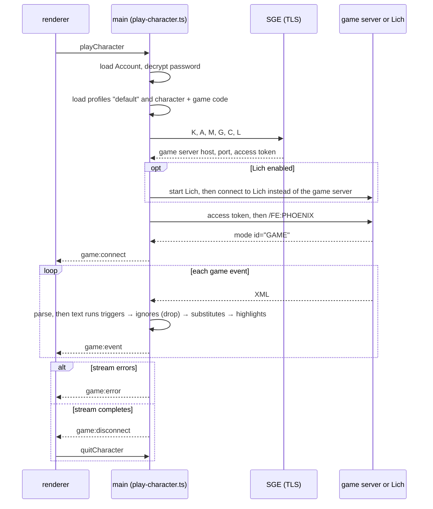

---
paths:
  - 'electron/main/**'
---

# Main process (`electron/main/`)

## Layers

Lower layers may not import higher ones.
`import/no-restricted-paths` in `eslint.config.js` enforces this, so `yarn lint` fails on a violation.

| Layer | Folders                                                                        |
| ----- | ------------------------------------------------------------------------------ |
| 0     | `logger`                                                                       |
| 1     | `async`, `cache`, `tls`, `setting`, `layout`                                   |
| 2     | `preference`, `account`, `sge`                                                 |
| 3     | `game`, `lich`                                                                 |
| 4     | `ipc`, plus the app shell: `menu`, `electron-next`, `chrome`, `sentry`         |
| root  | `index.ts` loads `initialize-app.ts`, which builds services and the app window |

## Module shape

Copy the nearest sibling module instead of inventing a new shape.
A module folder usually holds:

- `types.ts` for its interfaces.
- `<name>.service.ts` for the implementation, as `<Name>ServiceImpl implements <Name>Service`.
- `<name>.instance.ts` for the app's singleton, wired to real Electron paths; tests build the service directly with mocks instead.
- `logger.ts` for the module's scoped logger.
- `__tests__/<name>.test.ts`, and `__mocks__/<name>.mock.ts` for other modules' tests to use.

A new kind of setting should copy `electron/main/setting/ignore/`, and `electron/main/setting/README.md` explains the Genie format (see decision 0001).

## Game session

`electron/main/ipc/handlers/play-character.ts` assembles a game session, and it is the one file where the lower layers meet.

- Triggers see every line, including lines an ignore then drops.
- Only one Character plays at a time, because `Game` is a singleton.
- The parser is `electron/main/game/game.parser.ts`.
  - It drops unknown tags silently.
  - Bold can span lines.
  - Text with no stream id goes to `main`.
  - Protocol samples live in `electron/main/game/__tests__/`.

## IPC

To add a renderer → main call:

1. Add the method to `appAPI` in `electron/preload/index.ts`, with the channel string equal to the method name.
2. Run `yarn build:preload` to regenerate `electron/preload/index.d.ts` (decision 0002).
3. Add a handler factory in `electron/main/ipc/handlers/`; it receives the payload as `args[0]`.
4. Register it in `createHandlerRegistry()` in `electron/main/ipc/ipc.controller.ts`; the registry type won't compile until you do.

To add a main → renderer event:

1. Add the payload type to `electron/common/game/types.ts` and an overload to `IpcDispatcher` in `electron/main/ipc/types.ts`.
2. Call `dispatch(...)` from a handler; preload needs no change.
3. Subscribe in the renderer (see the renderer rules).

Payloads cross a process boundary, so:

- They must be structured-clone safe: no functions or class instances.
- They are not validated at runtime.
- A handler's error reaches the renderer only as a message string prefixed `[IPC:<CHANNEL>:ERROR:...]`.
- `dispatch` silently drops events once the app window is destroyed.

## User data

`yarn start:dev` uses the real user data folder (`~/Library/Application Support/Phoenix` on macOS).
Phoenix's files are under its `phoenix/` subfolder: `settings/<profile>/*.cfg`, `layouts/<name>.json` and `preferences.json`.
Main and preload changes need a restart of `yarn start:dev`; only the renderer hot-reloads.
